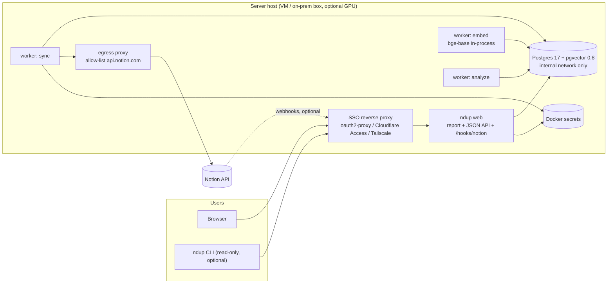
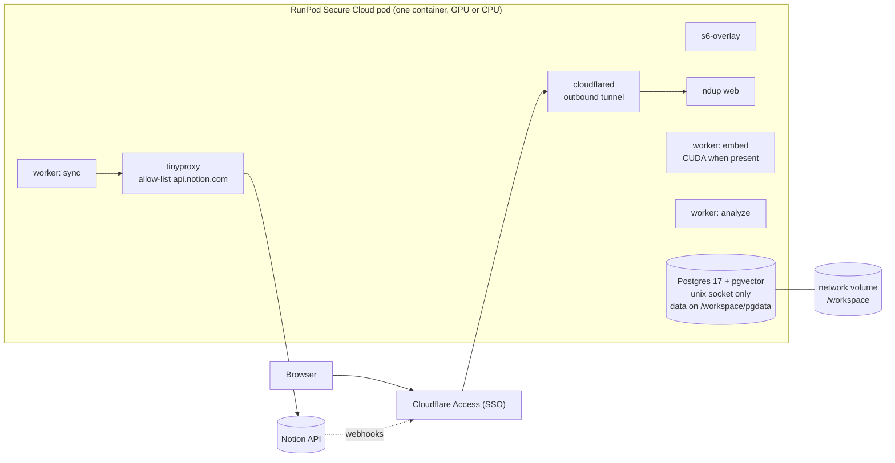
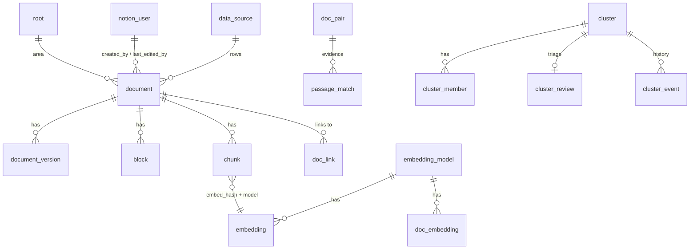
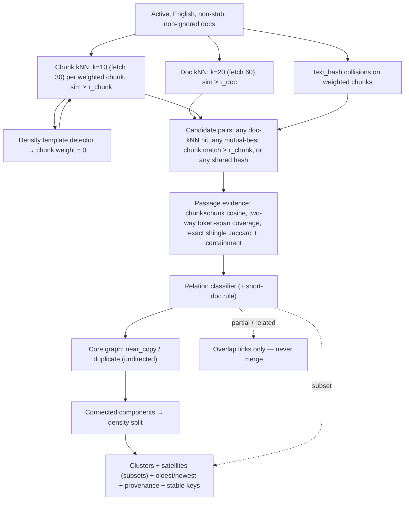

# `ndup` — Notion Semantic Duplication Detector: Architecture v3

> Status: design v3 (review findings resolved) · Supersedes v2 · Companion: [implementation-plan.md](./implementation-plan.md)
> Working name: **`ndup`** (Notion de-dup). Rename freely.

---

## 0. What changed from v2 and why

Every v2 decision in the TL;DR stands. v3 fixes the places where v2 relied on something the Notion API, pgvector, or Docker do not actually provide, and tightens the detection math for a workspace dominated by short database rows.

| # | v2 assumption | Verified reality | v3 change |
|---|---|---|---|
| 1 | Pages carry a teamspace | The REST API has no teamspace object. Team-level pages report `parent.type = "workspace"` | **Areas**: operator-labeled roots replace teamspace everywhere (§5.2.1, §7) |
| 2 | Search enumerates everything and is a reliable change feed | Notion documents search as *not* guaranteed to return everything, with indexing delay, and only directly shared pages guaranteed | **Three discovery channels**: search as a hint, tree traversal as ground truth, webhooks as the low-latency path (§5.2) |
| 3 | `web` on an `internal` network with a published port | Docker silently drops published ports for containers attached only to internal networks | `web` joins a `frontend` network with the SSO proxy (§8) |
| 4 | HNSW built after the first embedding pass, while partial analysis runs during sync | Without the index every kNN is a sequential scan | Indexes created at model registration (§7.1) |
| 5 | One `content_hash` keys both the embedding cache and verbatim-copy detection | Embedded text includes title/heading prefix, raw text does not | `text_hash` and `embed_hash` (§6, §7) |
| 6 | Analysis tables keyed by `run_id` | Incremental runs need current state, not snapshots | Current-state pair/cluster tables plus `cluster_event` for trends (§7, §9.6) |
| 7 | τ from the 99.5th percentile of random pairs | 0.5 % per pair is thousands of false neighbors per doc at 150k docs | Labeled-pair calibration first, p99.9 floor as sanity, short-doc rule (§9.3) |
| 8 | Candidates pruned by `doc_sim` | Pruning deletes the subset cases chunk kNN exists to find | Prune on chunk evidence only (§9.1) |
| 9 | Hash-based boilerplate catches templates | Partially filled templates differ by hash but not by cosine | Density-based row-template detection, title prefix suppressed for templated titles (§6.1) |
| 10 | English-only model, "everything" scope | Non-English text collapses into one region and clusters with itself | Language ID per chunk, non-English reported separately (§6.1) |
| 11 | `subset` is a strong clustering edge | Subsets chain unrelated docs | Subsets attach as satellites, never merge (§9.4) |
| 12 | pgvector ≥ 0.7 | Filtered kNN under-fills without iterative scans | pgvector ≥ 0.8, `hnsw.iterative_scan`, over-fetch (§7.1) |
| 13 | Trust `X-Forwarded-Email` | Forgeable from the host or any container on the network | Signed proxy assertion per SSO stack, read-only DB role for web, CSRF (§12.3) |
| 14 | Purge = delete markdown, chunks, vectors | Shared embedding rows, cluster labels, pair tables survived | Purge procedure with embedding GC (§5.7) |
| 15 | Incremental rows cost "a few requests" | One query per data source per hour | Adaptive per-source polling, webhooks (§5.6) |
| 16 | ~3 requests per page | Every nested container is a call; empty bodies still cost one | `init` samples the real workspace and computes the estimate (§5.5) |
| 17 | Solo mode on Apple Silicon at MPS speed | Docker Desktop has no MPS passthrough | Native `uv tool install` path for laptops; Docker solo is CPU (§8) |
| 18 | Reviewed clusters stay reviewed | New duplicates joining go unnoticed | `changed` status with membership diff; stable-key tie-break (§9.5, §10) |
| 19 | NEWEST / active copies from `last_edited_time` | Property and automation edits bump it | Content-change timestamps from observed versions (§10) |
| 20 | `content_mode` defined once | Doc lens and pair diff render full text regardless | Per-surface redaction table, enforced server-side (§12.4) |
| 21 | Compose on a VM was the only server target | Decision: host on a RunPod Secure Cloud GPU pod. RunPod runs one container per pod and has no Compose | **Pod mode**: single-container image with embedded Postgres on a network volume, Cloudflare Tunnel + Access (§3.4, §8.1, §12.7) |

Smaller fixes: handle `529 service_overload` like `429`; one worker container per role so an analysis OOM cannot stop sync; Prometheus metrics; token rotation; chunk-overlap tokens counted once in coverage; `block` autovacuum tuning; indexes on `cluster_member.doc_id` and `passage_match`; Mermaid subgraph titles quoted; `2025-09-03` is a deliberate pin, `2026-03-11` exists.

---

## 1. TL;DR — key decisions (unchanged unless marked)

| Area | Decision |
|---|---|
| Scale target | Org of 300–500 people → design for **≤ 300k documents (pages + DB rows), ≤ 1M chunks** |
| Language | **Python 3.12**; CLI with **Typer** + **Rich** |
| Distribution | **One Docker image** (Python + model weights baked in) + `docker compose`; viewers need only a browser. **v3:** native `uv tool install ndup[local]` for laptops |
| Deployment | **Team server mode (recommended)**: one shared host ingests once, serves the report behind company SSO. **v3:** the host is a **RunPod Secure Cloud pod** (single-container pod mode, §3.4) or a VM running compose. **Solo mode**: same image on a laptop for a scoped subset |
| Notion access | One internal integration token held **only on the sync worker**; single async sync process, shared token bucket at **3 req/s**, durable work queue → resumable. **v3:** optional webhook receiver |
| Content scope | **Everything**: all pages **and** all database rows. **v3:** non-English docs are synced but reported separately, not clustered |
| Embeddings | **Local only — content never leaves the host.** Default **`BAAI/bge-base-en-v1.5`** via sentence-transformers (ONNX on CPU / CUDA on GPU / MPS native). No remote provider exists in the codebase |
| Storage | Local **Postgres 17 + pgvector ≥ 0.8**, `halfvec`, per-model partial HNSW indexes created up front |
| Detection | Candidates (doc-kNN ∪ chunk-kNN ∪ hash) → passage evidence (two-way coverage + lexical) → typed relations → clusters on strong **undirected** edges, subsets as satellites |
| Keep/merge decision | **No canonical scoring. The user decides.** Clusters show **Oldest** and **Newest** plus provenance |
| Organizational dimension | **v3: Areas** (operator-labeled roots) instead of teamspaces, which the API does not expose |
| Visualization | Server-rendered web report + Rich terminal tables |
| Write-back to Notion | **None.** Read-only integration |
| Language support | English only for detection; other languages detected and counted |

---

## 2. Stack & rationale

| Need | Choice | Why |
|---|---|---|
| Core language | Python 3.12 | Local-ML ecosystem, clustering, UMAP, pgvector client |
| CLI | Typer + Rich | Typed commands, tables, progress |
| Web server | FastAPI + Uvicorn, Jinja2, vanilla JS + vendored Cytoscape.js and Plotly | Shared report, access control, no JS toolchain |
| HTTP to Notion | httpx (async) | Controlled concurrency under a strict rate limit; `respx` for tests |
| DB driver | psycopg 3 + `pgvector` adapter | COPY bulk loads, async, halfvec |
| Migrations | Numbered `.sql` files + tiny runner | Per-model index DDL generated at runtime |
| Embedding runtime | sentence-transformers, `backend="onnx"` int8 on CPU, PyTorch CUDA on GPU, PyTorch MPS on native macOS | 2–3× CPU speedup from ONNX; MPS only outside Docker |
| Language ID | fastText `lid.176.ftz` (≈ 1 MB, offline) | Cheap per-chunk language detection |
| Lexical similarity | `datasketch` MinHash for candidates; exact 5-word shingle Jaccard and containment at evidence time | Containment catches short-in-long copies that Jaccard penalizes |
| Clustering / projection | scikit-learn, networkx, umap-learn | Batteries included |
| Metrics | `prometheus_client` on worker and web | `doctor` reads the same counters |
| Packaging | Docker image `ghcr.io/<org>/ndup:<ver>` (CPU) and `:<ver>-cuda`; `uv` for dev and native install | Offline runtime; no torch install pain for operators |

---

## 3. Deployment modes & system overview

### 3.1 Why a shared server is the default
A full first sync takes one to a few days of API time at 3 req/s (§5.5). One host ingests once; everyone reads the same results.

| | **Team server mode** | **Solo mode** |
|---|---|---|
| Who | One operator; 5–500 viewers | One person, scoped subset (`--root`) |
| Postgres | Shared, on the server host, not exposed off-host | Local |
| Notion token | Sync worker only | Laptop keychain |
| Access for others | Browser via SSO; optional read-only CLI | None |
| Sync | Continuous: webhooks (optional) + hourly incremental + weekly reconcile | Manual `ndup sync` |
| Runtime | Docker | Docker (CPU) or native `uv tool install ndup[local]` (CPU/MPS) |

### 3.2 Team server topology



Outbound traffic from the containers: `api.notion.com` only, through the egress proxy. The host additionally talks to the IdP for SSO and to the container registry at install time. The embedder runs with `HF_HUB_OFFLINE=1`.

### 3.3 Pipeline

```
 discover ─► fetch blocks ─► render ─► chunk ─► embed ─► analyze ─► web / show
 (search +   (work queue,    (blocks→   (heading   (local,    (candidates →
  tree +      3 req/s)        MD +       aware,     batched,   evidence →
  webhooks)                   provenance) lang ID)  cached)    clusters)
       └──── separate worker roles, each idempotent & resumable, coordinated through Postgres ────┘
```

Sync, embedding, and analysis are pipelined across three worker containers. HNSW indexes exist from the start, so partial analysis works on day one. The UI shows a "first sync 63 % complete" banner until the first full pass finishes.

### 3.4 RunPod pod mode (single-container host)

RunPod runs exactly one container per Pod and does not support Docker Compose, so team server mode gets a second packaging: the **`ndup-pod`** image bundles Postgres 17 + pgvector, the three worker roles, the web app, an egress proxy, and `cloudflared` under an s6 supervisor. Everything persistent lives on a **network volume** mounted at `/workspace`; the container disk is wiped on every restart.



Rules:
- **Secure Cloud only.** Network volumes exist only there, and content must not sit on community-hosted hardware.
- **One pod per volume at a time.** The entrypoint takes a lease file on the volume with the pod id and a heartbeat; a second pod refuses to start Postgres while a live lease exists. Two Postgres instances on one data directory would destroy it.
- **GPU is elastic.** Deploy a GPU pod for the first sync and for re-embeds, stop it, and deploy a CPU pod on the same volume for steady state. `device = "auto"` picks CUDA when present. Both pod types must be in the volume's data center, so pick a data center that offers both.
- **No inbound ports.** `cloudflared` opens an outbound tunnel. Cloudflare Access enforces SSO in front of it and signs every request with a JWT the app verifies. `/hooks/notion` is published through the same tunnel with an Access bypass for that path, protected by the Notion signature. Fallback without Cloudflare: expose the web port through RunPod's HTTP proxy with oauth2-proxy inside the container; that URL is public and the pod id is obscurity, not auth.
- **Egress is process-level.** RunPod has no per-pod firewall, so the workers route through an in-container proxy allow-list, and the embedder's no-egress test still applies. `cloudflared` and `web` additionally reach Cloudflare and the IdP JWKS.
- **Requests through Cloudflare time out at about 100 s.** Exports and heavy queries run as background jobs with polling.
- **Secrets arrive as environment variables** from RunPod Secrets; `secrets.py` already falls back from `/run/secrets` to env. s6 injects the Notion token into the sync role's environment only. Config lives on the volume at `/workspace/config/ndup.toml`.
- **Backups leave the platform.** A daily `ndup db backup --state-only` goes to the org's object store (an egress allow-list entry). When an account balance reaches zero RunPod stops the pod and eventually terminates the volume.

Sizing: a single mid-range Secure Cloud GPU pod (RTX 4090, L4, A40 class) comes with 16+ vCPU and 48–64 GB RAM, above what §7.2 needs; 100 GB network volume; 40 GB container disk. A 24/7 GPU pod costs a few hundred dollars a month, a CPU pod a fraction of that, plus storage at about $0.07/GB/month. Verify current prices before committing.

Data boundary: in pod mode content is at rest on a RunPod Secure Cloud volume and in memory on RunPod hardware. "Content never leaves the host" still holds, but the host is rented. This needs a processor agreement with RunPod and a decision on encryption at rest (§12.7).

---

## 4. Repo layout

```
ndup/
├── pyproject.toml            # extras: [gpu], [local] (torch+MPS for native macOS)
├── uv.lock
├── Dockerfile                # multi-stage; bakes model weights + lid.176.ftz
├── docker-compose.yml        # db + egress + worker-sync + worker-embed + worker-analyze + web + proxy
├── docker-compose.solo.yml   # db + cli
├── Dockerfile.pod            # ndup + Postgres 17/pgvector + s6-overlay + cloudflared + tinyproxy (RunPod, any single-container host)
├── pod/                      # s6 service definitions, entrypoint (lease, initdb, migrate), backup cron
├── deploy/
│   ├── oauth2-proxy.example.cfg
│   ├── cloudflare-access.md
│   ├── tailscale.md
│   ├── Caddyfile.example
│   ├── egress-proxy.conf     # tinyproxy/squid allow-list
│   └── runpod/               # pod template JSON, deploy.sh (RunPod REST), cloudflared config, runbooks
├── src/ndup/
│   ├── cli/                  # init, db, sync, embed, analyze, show, review, ignore, web, worker, doctor, export, purge, calibrate, secrets, models
│   ├── config.py             # pydantic-settings, profiles
│   ├── secrets.py            # Docker secrets / keyring / env, redaction, rotation
│   ├── notion/
│   │   ├── client.py         # versioned headers, 429/529 handling, retry/backoff
│   │   ├── ratelimit.py      # token bucket (single-process, async)
│   │   ├── discovery/        # search.py, tree.py, data_sources.py, webhooks.py, ancestry.py
│   │   ├── fetcher.py        # work-queue consumer, block trees, child enqueue
│   │   ├── render.py         # block → Markdown + offset map + provenance
│   │   ├── estimate.py       # sampling-based request/ETA estimate
│   │   └── users.py
│   ├── text/{chunker.py, boilerplate.py, minhash.py, shingles.py, langid.py}
│   ├── embed/{base.py, st_provider.py, fake_provider.py, registry.py}
│   ├── db/{migrations/, migrate.py, queue.py, purge.py, roles.sql, queries/}
│   ├── analysis/{candidates.py, evidence.py, relations.py, clustering.py, stable_keys.py, provenance.py, topics.py, projection.py, calibrate.py, templates.py}
│   ├── web/{app.py, auth/, redact.py, audit.py, hooks.py, routes/, templates/, static/}
│   ├── metrics.py
│   └── tui/tables.py
└── tests/{unit/, integration/, e2e/, fixtures/notion/, golden/}
```

---

## 5. Notion ingestion

### 5.1 Access model
- One **internal integration** with **read content** + **read user information incl. emails** only. No insert/update capabilities, so the tool is read-only by construction.
- The integration sees pages **explicitly connected to it** and their descendants. What gets connected defines the data boundary (§12).
- Pin `Notion-Version: 2025-09-03` (databases contain **data sources**; rows via `POST /v1/data_sources/{id}/query`). `2026-03-11` exists; upgrading is a deliberate, tested step.
- Rate limit: average 3 req/s per integration. Both `429 rate_limited` and `529 service_overload` carry `Retry-After`; honor it and pause the bucket.

### 5.2 Discovery: three channels

Notion's own docs say search "is not guaranteed to return everything," its index "may change as your connection iterates," indexing "is not immediate," and only pages shared *directly* with the connection are guaranteed to appear. So search is a **hint**, not the source of truth.

| Channel | Role | Cost |
|---|---|---|
| **Search** (`POST /v1/search`, `filter_properties=title`, sorted by `last_edited_time` desc) | Fast first pass and hourly change hint. Stops at the watermark minus a 15-minute lag buffer | ≈ docs / 100 requests |
| **Tree traversal** | Ground truth. Every `child_page` / `child_database` block seen while fetching enqueues its target. Every data source is queried for all rows. Roots come from config, from search results with `workspace` parent, and from `GET /v1/databases/{id}` → `data_sources[]` | Free for pages, since blocks are being fetched anyway; ≈ rows / 100 for data sources |
| **Webhooks** (optional, recommended) | Minute-latency change and deletion signal. Subscribe to `page.content_updated`, `page.created`, `page.deleted`, `page.undeleted`, `page.moved`, `page.properties_updated`, `data_source.content_updated`, `data_source.schema_updated`, `database.deleted` | None against the rate limit |

Each discovered doc is upserted into `sync_task` with a priority and `discovered_via`. Webhook-triggered tasks get the highest priority.

#### 5.2.1 Ancestry, areas, exclusion
Page objects give only the immediate parent, so the chain is resolved locally:

```
resolve(doc):
  walk parent_id through documents already known
  unknown parent → GET /v1/pages/{id} or GET /v1/databases/{id} (metadata only, cached as a stub row)
  404 → parent is not shared with the integration → this doc is a root for ndup
area(doc) = label of the nearest ancestor present in `root`, else the title of the top-most reachable ancestor
excluded(doc) = any resolved ancestor is in exclude_roots
```

- `root` rows come from `config.notion.roots` (`{url, label}`) and are auto-created for any discovered top-level page or database with a default label equal to its title. Operators relabel in config; labels are what the UI calls **Area**.
- Excluded docs are stored as `status = 'excluded'` with id only, before any block fetch. Their title, received through search, is not persisted.
- A page that moves (webhook `page.moved` or a changed `parent_id` at fetch) is re-resolved; moving into an excluded root triggers purge.

### 5.3 Durable work queue (resumable sync)

```sql
CREATE TABLE sync_task (
  doc_id uuid PRIMARY KEY,
  kind text NOT NULL,                     -- page | db_row | data_source | database
  priority int NOT NULL,                  -- lower = sooner; webhook = 0
  remote_last_edited timestamptz,
  discovered_via text,                    -- search | tree | webhook | data_source | reconcile
  state text DEFAULT 'pending',           -- pending | in_progress | done | failed | gone
  attempts int DEFAULT 0, next_attempt_at timestamptz, last_error text,
  leased_until timestamptz);
CREATE INDEX ON sync_task (state, priority, next_attempt_at);
```

- Fetchers claim with `SELECT … FOR UPDATE SKIP LOCKED` plus a lease; crashed processes resume, expired leases are re-claimed.
- A page's whole block tree is fetched, then written in **one transaction** (document, blocks, version, chunks). Children found in the tree are enqueued in the same transaction.
- Discovery cursors are checkpointed in `sync_state`. Expired cursors restart discovery; tasks are upserted, not duplicated.
- Failures back off exponentially (max 6 attempts), then `failed` for `doctor`.
- **Priority:** (0) webhook-triggered; (1) standalone pages, newest-edited first; (2) rows of data sources with substantial bodies; (3) remaining rows.

### 5.4 Parallelism within the rate limit
- All Notion calls go through the **sync worker's** single async token bucket (rate 3/s, burst 3) with up to ~6 requests in flight.
- On `429`/`529`, honor `Retry-After` and pause the bucket. On other `5xx`/timeouts, jittered exponential backoff.
- Throughput levers: `page_size=100`; `filter_properties=title` on search; skip unchanged pages by `last_edited_time`; `has_children` to avoid empty child calls; pipeline embedding and analysis; `--root` / `exclude_roots`.
- **Rejected:** sharding across multiple integration tokens.

### 5.5 Scale estimate is measured, not assumed
Every nested container (toggle, column, table, list item with children, callout with children) is its own `GET /v1/blocks/{id}/children`, and a row with an empty body still costs one call to find that out. v2's "~3 requests per page" is a guess that can be low by half.

`ndup init` and `ndup sync --estimate`:
1. Discover roots and data sources (cheap).
2. Sample 300 pages and 300 rows, stratified by data source, and fetch them fully.
3. Record `requests/page`, `requests/row`, `tokens/doc`, `empty-body share` in `sync_state.estimate` and print an ETA range.

Reference numbers to sanity-check the sample against, at 3 req/s:

| Workspace | Docs | Requests (3–6 per page, 1.2 per row) | First sync |
|---|---|---|---|
| Medium | 50k | 90k–140k | 8–13 h |
| **Expected** | **150k** | **270k–420k** | **25–40 h** |
| Large | 300k | 540k–840k | 50–78 h |

### 5.6 Incremental sync

```
every minute (if webhooks enabled):
  /hooks/notion → verify signature → webhook_event → upsert sync_task(priority 0)

hourly:
  search pages + data sources desc, stop at watermark − 15 min  (hint channel)
  poll data sources whose next_poll_at is due:
      query filter last_edited_time > source watermark
      interval adapts: 1 h while the source changed in the last 7 d, else daily, bounded [1 h, 7 d]
  fetch changed docs; unchanged content_hash → metadata touch only

daily:
  refresh users; poll cold data sources

weekly:
  full reconcile = search + tree traversal from every root + every data source
  docs not seen → GET /v1/pages/{id}: in_trash / archived / 404 → status gone → purge
```

Hourly polling cost is bounded by the number of *hot* data sources rather than all of them. With webhooks enabled, most changes arrive within a minute and the hourly pass is a safety net.

### 5.7 Purge
A doc becomes `gone` (trashed, unshared, 404) or `excluded` (moved under an excluded root, `ndup purge --doc`). `purge_document(doc_id)` runs in one transaction:

1. Delete `chunk`, `block`, `document_version`, `doc_embedding`, `doc_link`, `passage_match`, `doc_pair`, `cluster_member`, `calibration_label` rows for the doc (FK cascades where declared).
2. Null `document.markdown`, `properties`, `title`, `breadcrumb`, `contributors`; keep id, `title_hash`, dates, `status`.
3. Delete `embedding` rows whose `embed_hash` is no longer referenced by any chunk (immediately for the purged hashes; a nightly GC catches stragglers).
4. Recompute labels and `member_hash` for touched clusters; emit `cluster_event left`.
5. `audit_log` stores `target_id`, never titles.

Version history is capped at 180 days. Non-English and stub docs follow the same lifecycle.

### 5.8 Block → text rendering
Render to Markdown with a **block offset map** (`block_id → char range`) and capture each block's `created_by / created_time / last_edited_by / last_edited_time`.

| Block | Rendering |
|---|---|
| paragraph, quote, callout, toggle, lists, to_do | text; children inlined |
| heading_1/2/3 | `#` levels; drive chunk boundaries |
| code, equation | kept (code down-weighted) |
| table | pipe rows |
| column_list/column | recurse |
| **synced_block** | rendered once, chunks `is_synced` → excluded (intentional reuse) |
| child_page / child_database | link only + **enqueue child** |
| link_to_page, mentions | link text + `doc_link` edge |
| media/file/embed/bookmark | caption only |

**Database rows:** title and `rich_text` properties are prepended to the body. Structured properties go to `properties jsonb` for filters and display only. Property text has no block provenance; its deep link is the page.

### 5.9 Users
`GET /v1/users` → `notion_user`, refreshed daily. Unresolvable IDs display as `Unknown user (a1b2…)`.

---

## 6. Chunking & local embeddings

### 6.1 Chunking, language, boilerplate
- Heading-aware: split on H1–H3, pack blocks to ~300 tokens target, 512 max, 1-block overlap. A single block over 512 tokens is split on sentence boundaries. Tokens counted with the model tokenizer.
- **Embedded text** = `"{title} > {H1} > {H2}\n\n{text}"` for pages. For **rows**, the title is included only when it is not templated: `data_source.template_title` is set when one title covers ≥ 5 % of rows, and such titles are dropped from the prefix.
- **Two hashes per chunk**: `text_hash` = sha256 of normalized raw text (collisions, boilerplate, MinHash identity); `embed_hash` = sha256 of the embedded text (embedding cache key).
- **Language ID** per chunk (fastText lid.176); `document.lang` = token-weighted majority. Only `lang = 'en'` docs enter candidates. The overview shows "N docs in other languages, not analyzed".
- **Stubs** (< 40 tokens) excluded from clustering; exact-title duplicates among stubs reported separately.
- **Boilerplate**, three detectors, all set `chunk.weight = 0` and `boilerplate_reason`:
  - `hash`: `text_hash` in ≥ `max(20, 0.05 % of docs)` docs.
  - `row_template`: `text_hash` in ≥ 30 % of rows of one data source (min 10 rows).
  - `density`: after chunk kNN, a chunk whose neighbors ≥ τ_chunk *within its own data source* span ≥ 30 % of that source's rows. This catches partially filled templates that hashing misses.

### 6.2 Doc vs chunk level
| Level | How | Used for |
|---|---|---|
| Chunk | embedded directly | passage evidence, chunk kNN, doc-lens gutter |
| Doc | weight × token weighted mean of chunk vectors, L2-normalized | doc kNN, 2D map, topic regions |

### 6.3 Model choice: `BAAI/bge-base-en-v1.5` (default)
Unchanged from v2. Throughput table corrected for where each runtime actually runs:

| Hardware | Runtime | bge-base | 300k chunks | 1M chunks |
|---|---|---|---|---|
| 8-core x86 server CPU | Docker, ONNX int8 | ~50–80 chunks/s | ~1–1.7 h | ~3.5–5.5 h |
| Apple M2/M3, **Docker** | ONNX, arm64 CPU | ~30–60/s | ~1.5–3 h | ~5–9 h |
| Apple M2/M3, **native** `[local]` | PyTorch MPS | ~150–300/s | ~20–35 min | ~1–2 h |
| NVIDIA T4 | CUDA fp16 | ~700–1,000/s | ~5–7 min | ~17–25 min |
| NVIDIA L4 / A10 / RTX 4090 | CUDA fp16 | ~2,000–3,000/s | ~2 min | ~6–8 min |

Verify with `ndup doctor --bench`. Notion's rate limit remains the bottleneck; a GPU is optional.

### 6.4 Provider interface (local-only)
```python
class EmbeddingProvider(Protocol):
    model: str; dims: int; max_tokens: int
    def embed(self, texts: list[str]) -> np.ndarray: ...   # L2-normalized float32
    def count_tokens(self, text: str) -> int: ...
```
Implementations: `st_provider`, `fake_provider`. A guard test asserts no provider imports an HTTP client; `doctor` runs the embedder with networking disabled. Cache keyed by `(model_id, embed_hash)`.

---

## 7. Postgres schema (pgvector ≥ 0.8)



```sql
CREATE EXTENSION IF NOT EXISTS vector;      -- doctor asserts version >= 0.8

CREATE TABLE notion_user (id uuid PRIMARY KEY, type text, name text, email text,
  avatar_url text, updated_at timestamptz);

CREATE TABLE root (id uuid PRIMARY KEY,                 -- top-level page or database id
  label text NOT NULL, kind text NOT NULL,              -- configured | discovered
  excluded bool DEFAULT false, created_at timestamptz);

CREATE TABLE data_source (id uuid PRIMARY KEY, database_id uuid, title text, row_count int,
  template_title text,                                  -- title covering >= 5 % of rows, if any
  poll_interval interval DEFAULT '1 hour', next_poll_at timestamptz,
  last_polled_at timestamptz, last_change_seen timestamptz, watermark timestamptz);

CREATE TABLE document (
  id uuid PRIMARY KEY, kind text NOT NULL,              -- page | db_row
  parent_type text, parent_id uuid, data_source_id uuid REFERENCES data_source,
  root_id uuid REFERENCES root, area text, breadcrumb text[],
  title text, title_hash bytea, url text,
  created_time timestamptz, created_by uuid,
  last_edited_time timestamptz, last_edited_by uuid,    -- as reported by Notion (any touch)
  last_content_change timestamptz,                      -- observed: content_hash changed (null until first observed change)
  properties jsonb, markdown text, content_hash bytea, token_count int,
  lang text, contributors uuid[],
  is_stub bool DEFAULT false,
  status text DEFAULT 'active',                         -- active | gone | excluded | ignored
  discovered_via text, first_seen_at timestamptz, last_synced_at timestamptz);
CREATE INDEX ON document (last_edited_time);
CREATE INDEX ON document (data_source_id);
CREATE INDEX ON document (parent_id);
CREATE INDEX ON document (root_id);
CREATE INDEX ON document (status) WHERE status <> 'active';

CREATE TABLE document_version (doc_id uuid REFERENCES document ON DELETE CASCADE, content_hash bytea,
  last_edited_time timestamptz, last_edited_by uuid, markdown_zstd bytea, synced_at timestamptz,
  PRIMARY KEY (doc_id, content_hash));                  -- retention: 180 days

CREATE TABLE block (id uuid PRIMARY KEY, doc_id uuid REFERENCES document ON DELETE CASCADE,
  type text, start_char int, end_char int,
  created_time timestamptz, created_by uuid, last_edited_time timestamptz, last_edited_by uuid,
  is_synced bool DEFAULT false)
  WITH (autovacuum_vacuum_scale_factor = 0.02, autovacuum_analyze_scale_factor = 0.01);
CREATE INDEX ON block (doc_id);

CREATE TABLE doc_link (src uuid, dst uuid, PRIMARY KEY (src, dst));

CREATE TABLE chunk (id bigserial PRIMARY KEY,
  doc_id uuid REFERENCES document ON DELETE CASCADE, ord int,
  heading_path text[], text text, start_char int, end_char int, block_ids uuid[],
  token_count int,
  text_hash bytea NOT NULL,                              -- raw text: collisions, boilerplate, MinHash
  embed_hash bytea NOT NULL,                             -- prefixed text: embedding cache key
  minhash bytea, lang text,
  weight real DEFAULT 1,                                 -- 0 boilerplate/synced · 0.5 code-heavy · 1
  is_boilerplate bool DEFAULT false, boilerplate_reason text,   -- hash | row_template | density
  is_synced bool DEFAULT false,
  UNIQUE (doc_id, ord))
  WITH (autovacuum_vacuum_scale_factor = 0.02);
CREATE INDEX ON chunk (text_hash);
CREATE INDEX ON chunk (embed_hash);

CREATE TABLE embedding_model (id smallserial PRIMARY KEY, model text, dims int,
  storage text DEFAULT 'halfvec', is_active bool,
  thresholds jsonb,            -- {tau_chunk, tau_doc, short_doc_delta, source: shipped|labeled, n_labels, f1, p999_floor}
  created_at timestamptz, UNIQUE (model, dims));

CREATE TABLE embedding (model_id smallint, embed_hash bytea, vec halfvec NOT NULL,
  PRIMARY KEY (model_id, embed_hash));
CREATE TABLE doc_embedding (model_id smallint, doc_id uuid REFERENCES document ON DELETE CASCADE,
  vec halfvec NOT NULL, source_hash bytea, PRIMARY KEY (model_id, doc_id));

CREATE TABLE analysis_run (id serial PRIMARY KEY, model_id smallint, mode text,   -- full | incremental
  params jsonb, started_at timestamptz, finished_at timestamptz, stats jsonb);

-- Current state. Incremental runs upsert touched pairs and delete pairs that no longer qualify.
CREATE TABLE doc_pair (doc_a uuid REFERENCES document ON DELETE CASCADE,
  doc_b uuid REFERENCES document ON DELETE CASCADE,                           -- doc_a < doc_b
  doc_sim real, cov_ab real, cov_ba real, lex_jaccard real, lex_cont_ab real, lex_cont_ba real,
  score real, relation text,                                                 -- near_copy|duplicate|subset|partial|related
  first_run int, last_run int,
  PRIMARY KEY (doc_a, doc_b));
CREATE INDEX ON doc_pair (doc_b);
CREATE INDEX ON doc_pair (relation) WHERE relation IN ('near_copy', 'duplicate', 'subset');

CREATE TABLE passage_match (doc_a uuid, doc_b uuid, chunk_a bigint, chunk_b bigint, sim real, lex real,
  PRIMARY KEY (doc_a, doc_b, chunk_a, chunk_b),
  FOREIGN KEY (doc_a, doc_b) REFERENCES doc_pair ON DELETE CASCADE);

CREATE TABLE cluster (stable_key uuid PRIMARY KEY,
  label text, size int, member_hash bytea,               -- sha256 of sorted member ids
  oldest_doc uuid, newest_doc uuid, active_copies int,
  areas text[], last_run int, updated_at timestamptz);
CREATE TABLE cluster_member (stable_key uuid REFERENCES cluster ON DELETE CASCADE,
  doc_id uuid REFERENCES document ON DELETE CASCADE,
  relation_to_cluster text,                              -- near_copy | duplicate | subset | superset
  is_satellite bool DEFAULT false,                       -- subset attached, not a core member
  PRIMARY KEY (stable_key, doc_id));
CREATE INDEX ON cluster_member (doc_id);

CREATE TABLE cluster_event (id bigserial PRIMARY KEY, stable_key uuid, doc_id uuid,
  event text,                                            -- joined | left | split_from | merged_into
  run_id int, at timestamptz);                           -- feeds Trends; retention 400 days
CREATE INDEX ON cluster_event (at);

CREATE TABLE cluster_review (stable_key uuid PRIMARY KEY,
  status text,                                           -- open | reviewed | not_duplicate | changed
  reviewed_member_hash bytea, note text, reviewed_by text, reviewed_at timestamptz);
CREATE TABLE ignore_rule (id serial PRIMARY KEY, kind text, a uuid, b uuid,
  created_by text, created_at timestamptz, UNIQUE (kind, a, b));
CREATE TABLE calibration_label (doc_a uuid, doc_b uuid, label text,   -- duplicate | not_duplicate | subset
  labeled_by text, labeled_at timestamptz, PRIMARY KEY (doc_a, doc_b));

CREATE TABLE sync_state (key text PRIMARY KEY, value jsonb);
-- sync_task: see §5.3
CREATE TABLE webhook_event (id uuid PRIMARY KEY, type text, entity_id uuid,
  received_at timestamptz, processed_at timestamptz);
CREATE TABLE audit_log (at timestamptz, user_email text, action text,
  target_kind text, target_id uuid);                     -- never titles or text
CREATE INDEX ON audit_log (at);
```

**Roles** (`db/roles.sql`): `ndup_worker` owns everything. `ndup_web` has `SELECT` on all tables, `INSERT/UPDATE` on `cluster_review`, `ignore_rule`, `audit_log`, `calibration_label`, and `INSERT` on `webhook_event` and `sync_task`. Nothing else.

### 7.1 Vector indexes
Vectors are untyped `halfvec`; indexes are per-model partial expression indexes, **created at model registration**, before any embedding is written:

```sql
CREATE INDEX CONCURRENTLY emb_hnsw_m1 ON embedding
  USING hnsw ((vec::halfvec(768)) halfvec_cosine_ops)
  WITH (m = 16, ef_construction = 64) WHERE model_id = 1;
CREATE INDEX CONCURRENTLY docemb_hnsw_m1 ON doc_embedding
  USING hnsw ((vec::halfvec(768)) halfvec_cosine_ops) WHERE model_id = 1;
```

- Queries repeat the exact cast and a **literal** `WHERE model_id = 1` (generic plans do not match partial-index predicates on parameters).
- Analysis sessions set `hnsw.ef_search = 100` and `hnsw.iterative_scan = relaxed_order` so filtered kNN (exclude same doc, boilerplate, stubs, non-active) still returns k rows. Candidate queries over-fetch 3×k before filtering.
- Incremental inserts maintain the index; at < 100 chunks/s the cost is negligible. `ndup db reindex` rebuilds with parallel workers after a model switch.

### 7.2 Storage & server sizing
Unchanged: ~6–7 GB expected, ~15–17 GB large. Recommended 8 vCPU, 32 GB RAM, 100 GB SSD, GPU optional. Postgres `shared_buffers=8GB`, `effective_cache_size=20GB`, `maintenance_work_mem=4GB`. Worker memory limits: sync 1 GB, embed 4 GB, analyze 8 GB.

---

## 8. Containers

```yaml
# docker-compose.yml (team server)
services:
  db:
    image: pgvector/pgvector:pg17          # ships pgvector >= 0.8
    environment: { POSTGRES_USER: ndup, POSTGRES_DB: ndup, POSTGRES_PASSWORD_FILE: /run/secrets/pg_password }
    secrets: [pg_password]
    volumes: [pgdata:/var/lib/postgresql/data]
    command: ["postgres", "-c", "shared_buffers=8GB", "-c", "maintenance_work_mem=4GB",
              "-c", "max_parallel_maintenance_workers=4"]
    networks: [internal]
    healthcheck: { test: ["CMD-SHELL", "pg_isready -U ndup"], interval: 2s, retries: 30 }

  egress:                                   # the only container with internet access
    image: ghcr.io/<org>/ndup-egress:1.0    # tinyproxy with an allow-list: api.notion.com
    networks: [internal, egress]

  worker-sync:
    image: ghcr.io/<org>/ndup:1.0
    command: ["ndup", "worker", "--role", "sync"]
    environment: { HTTPS_PROXY: "http://egress:8888" }
    secrets: [notion_token, pg_password_worker]
    volumes: [./config:/config]
    networks: [internal]
    depends_on: { db: { condition: service_healthy } }
    deploy: { resources: { limits: { memory: 1g } } }

  worker-embed:
    image: ghcr.io/<org>/ndup:1.0           # or :1.0-cuda with a GPU reservation
    command: ["ndup", "worker", "--role", "embed"]
    environment: { HF_HUB_OFFLINE: "1" }
    secrets: [pg_password_worker]
    networks: [internal]
    deploy: { resources: { limits: { memory: 4g } } }

  worker-analyze:
    image: ghcr.io/<org>/ndup:1.0
    command: ["ndup", "worker", "--role", "analyze"]
    secrets: [pg_password_worker]
    networks: [internal]
    deploy: { resources: { limits: { memory: 8g } } }

  web:
    image: ghcr.io/<org>/ndup:1.0
    command: ["ndup", "web", "--host", "0.0.0.0"]
    secrets: [pg_password_web, proxy_shared_secret, notion_webhook_token]   # no Notion API token
    networks: [internal, frontend]           # frontend is NOT internal, so the proxy can reach it
    # no published port: only the proxy container reaches it

  proxy:
    image: quay.io/oauth2-proxy/oauth2-proxy:v7   # or Caddy + Cloudflare Access / Tailscale, see deploy/
    volumes: [./deploy/oauth2-proxy.cfg:/etc/oauth2-proxy.cfg]
    ports: ["443:443"]
    networks: [frontend, egress]             # needs the IdP
    depends_on: [web]

secrets:
  notion_token:          { file: ./secrets/notion_token }          # chmod 600
  notion_webhook_token:  { file: ./secrets/notion_webhook_token }
  pg_password_worker:    { file: ./secrets/pg_password_worker }
  pg_password_web:       { file: ./secrets/pg_password_web }
  proxy_shared_secret:   { file: ./secrets/proxy_shared_secret }
volumes: { pgdata: {} }
networks:
  internal: { internal: true }   # db + workers + web
  frontend: {}                   # proxy ↔ web only
  egress: {}                     # egress proxy + SSO proxy
```

- The Notion token exists only in `worker-sync`. `web` and the other workers never see it.
- Postgres has no published port. `web` has no published port; only `proxy` does.
- `./setup.sh` writes the secret files before the first `docker compose up`, then runs `docker compose run --rm worker-sync ndup init`.
- Metrics: every container exposes `/metrics` on the internal network; `doctor` scrapes them.
- Backups: `ndup db backup --state-only` dumps the small tables that cannot be rebuilt from Notion (`cluster_review`, `ignore_rule`, `calibration_label`, `audit_log`, `root`); `--full` dumps everything.
- Token rotation: `ndup secrets rotate notion` validates the new token, swaps the secret file, and restarts `worker-sync`.

**Solo mode:** `docker-compose.solo.yml` runs `db` + a CLI container (CPU only). On Apple Silicon, `uv tool install "ndup[local]"` runs natively with MPS and a local Postgres container.

### 8.1 Single-container image (`ndup-pod`)

`Dockerfile.pod` layers on the application image so there is one codebase and one set of migrations:

```
FROM ghcr.io/<org>/ndup:1.0-cuda                 # app + baked model weights; CUDA libs are inert on a CPU pod
RUN apt-get install postgresql-17 postgresql-17-pgvector s6-overlay cloudflared tinyproxy
COPY pod/s6-rc.d/ /etc/s6-overlay/s6-rc.d/        # postgres, migrate (oneshot), worker-sync, worker-embed, worker-analyze, web, cloudflared, tinyproxy, backup-cron
COPY pod/entrypoint.sh /etc/cont-init.d/10-ndup   # lease, initdb on first boot, config check
ENTRYPOINT ["/init"]
```

Boot order: acquire `/workspace/ndup.lease` → `initdb` on first boot into `/workspace/pgdata` with `listen_addresses = ''` and a unix socket only → start Postgres → `ndup db migrate` → start workers and web → start `cloudflared` with the tunnel token. Postgres tuning is derived from the pod's RAM at boot (`shared_buffers` = 25 %). The analyze role enforces an in-process working-set cap because a single container has no per-service cgroup limits.

`deploy/runpod/` holds a pod template (image, env from RunPod Secrets, `/workspace` volume, no exposed HTTP ports when the tunnel is used) and `deploy.sh`, which calls the RunPod REST API to create the network volume once and then create, stop, or swap GPU and CPU pods against it. `ndup doctor` in pod mode also checks: volume mounted and writable, lease held by this pod, GPU visible to the embedder, tunnel connected, Postgres bound to the socket only, last off-platform backup age.

---

## 9. Duplicate detection algorithm



### 9.1 Candidates
- **Doc kNN** on `doc_embedding`: whole-doc duplicates.
- **Chunk kNN** on `embedding` joined to `chunk` by `embed_hash`: a section copied into a long doc.
- **Hash collisions** on `text_hash` with `weight > 0`.
- A pair is a candidate if **any** channel fires. There is no `doc_sim` pruning: a subset has low `doc_sim` by nature.

### 9.2 Passage evidence
For each candidate pair, `S = chunksA · chunksBᵀ`:
```
cov(A→B) = Σ tokens·w over A token spans whose chunk's best match in B ≥ τ_chunk / Σ tokens·w over A
           (spans deduplicated so 1-block overlap is counted once)
w = chunk.weight
lex_jaccard, lex_cont_ab, lex_cont_ba = exact 5-word shingle sets of both docs (cheap at pair time)
doc_sim = cosine(doc vectors)
passage_match = mutual-best (i, j) pairs ≥ τ_chunk
```

### 9.3 Relations and calibration

| Relation | Rule | UI meaning |
|---|---|---|
| `near_copy` | lex_jaccard ≥ 0.8, or both cov ≥ 0.9 with median match ≥ τ_chunk + 0.05 | copy-paste / fork |
| `duplicate` | cov_ab ≥ 0.6 and cov_ba ≥ 0.6 | same content, rewritten |
| `subset` | one cov ≥ 0.7 and the other < 0.4, or lex containment ≥ 0.7 one way | one doc inside the other |
| `partial` | max cov ≥ 0.25 | some sections overlap |
| `related` | doc_sim ≥ τ_doc, low coverage | same topic (not flagged) |

**Short-doc rule.** If either doc has ≤ 2 weighted chunks, `near_copy` and `duplicate` additionally require median match ≥ τ_chunk + `short_doc_delta` (default 0.05) **and** lexical support (containment ≥ 0.5 either way, or a shared `text_hash`). Otherwise the pair is `related`. This closes the gap where one chance match above τ gives two one-chunk docs 100 % mutual coverage.

**Calibration order of precedence:**
1. **Shipped defaults per model**, fitted on the golden synthetic workspace (§15) and stored in `embedding_model.thresholds` with `source = shipped`.
2. **`ndup calibrate`** on the real workspace: surfaces 30–50 borderline pairs, records `calibration_label`, refits τ_chunk, τ_doc, and `short_doc_delta` to maximize F1 on duplicate + near_copy. `source = labeled`.
3. **Sanity floor**: τ_chunk ≥ the 99.9th percentile of cosine over 1M random cross-doc chunk pairs. A percentile is a per-pair false-positive rate; at this scale it cannot be the primary setting, only a floor.
4. **Monitoring**: nightly, sample 5k docs, count kNN neighbors above τ that fail evidence. If the mean exceeds 0.2 per doc, `doctor` warns and recommends `--preset strict`.

Presets strict / default / loose shift τ by ±0.02.

### 9.4 Clustering
- **Core graph** on undirected `near_copy` and `duplicate` edges only. Connected components; for components with > 4 docs and edge density < 0.5, average-linkage split on `1 − score`.
- **Satellites**: a doc with only `subset` edges attaches to the cluster of its superset with `is_satellite = true`. If its supersets sit in different clusters it is listed under each as an overlap link; clusters never merge through a subset.
- **Topic regions** (overlay): HDBSCAN on a 10-D UMAP of doc vectors.
- Labels: top TF-IDF terms of core member titles and headings.

### 9.5 Stable keys and review state
- A new cluster inherits the `stable_key` of the previous cluster with the **largest intersection**; ties break toward the older key. The other previous clusters emit `merged_into` events, and their reviews are copied into the survivor's note history.
- On a split, the larger half keeps the key; the smaller gets a new key and a `split_from` event.
- `cluster.member_hash` is recomputed each run. If it differs from `cluster_review.reviewed_member_hash`, status becomes `changed` and the UI shows which members joined or left since the review.

### 9.6 Incremental analysis
Hourly: re-run candidates and evidence for docs whose `content_hash`, `weight`s, or status changed since the last run, plus their current pair partners. Upsert `doc_pair`; delete pairs for touched docs that no longer qualify; recompute clusters for affected components; emit `cluster_event`s. Nightly full run refreshes thresholds, density templates, UMAP, and topic regions. Relations are re-derived from stored raw scores when thresholds change, so a τ update does not require re-evidence.

### 9.7 Scalability of analysis

| Step | Expected (150k docs / 300k chunks) | Large (1M chunks) |
|---|---|---|
| Doc kNN, 8 connections, iterative scan | ~3–5 min | ~6–10 min |
| Chunk kNN, 3× over-fetch | ~5–10 min | ~15–30 min |
| Density template pass | ~1 min | ~3 min |
| Evidence, batched by doc, vectors via COPY | ~5–10 min | ~20–30 min |
| Clustering + UMAP (50k fit, transform rest) | ~5 min | ~10–15 min |
| **Full analysis** | **~20–30 min** | **~55–90 min** |

Incremental: ~1–3 min. Memory: evidence ≤ 2 GB working set. Optional FAISS accelerator not in MVP.

---

## 10. Newest vs oldest & provenance (no canonical scoring)

| Fact | Definition | Badge |
|---|---|---|
| **Oldest** | earliest `created_time` (ties → earliest first block) | `OLDEST` |
| **Newest** | latest **content change**: `last_content_change` where observed, else `last_edited_time` with a "any edit" tooltip | `NEWEST` |
| Creator / created, last editor / edited | page fields | |
| Contributors | distinct block creators/editors | |
| Active copies | members with a **content change** in the last 90 days, falling back to `last_edited_time` before the first observed change | ⚠ when > 1 |
| Location | **Area** + breadcrumb, data source name for rows | |
| Relation | near-copy / duplicate / subset / superset vs other members; satellites marked | |
| Likely passage origin | matched passage whose blocks have the earliest `created_time` | "first appeared in…" |

Caveats shown in tooltips: `last_edited_*` is bumped by property, relation, and automation edits; `ndup`'s version history starts at its first sync; passage origin follows block creation time, which a rewrite-in-place can distort.

---

## 11. Visualization design
Unchanged in structure from v2 (overview, cluster detail with graph and timeline, workspace map, pair diff, doc lens, trends), with these changes:

- Every "teamspace" becomes **Area**.
- Overview adds: "N docs in other languages (not analyzed)", "N stubs", and a `changed since review` filter.
- Cluster detail marks satellites and shows the membership diff when status is `changed`.
- Trends are computed from `cluster_event`.
- Each surface renders through `web/redact.py` according to `content_mode` (§12.4).

---

## 12. Multi-user: distribution, sharing, access & permissions

### 12.1 Distribution
| Persona | What they do |
|---|---|
| **Viewer** | Open `https://ndup.<company>.internal`, SSO. Nothing to install |
| **Power user** | `uv tool install ndup-client` or the shim; `ndup login --server …`; `ndup show …` |
| **Operator** | Provision a VM, `./setup.sh`, `docker compose up -d`, configure the proxy from `deploy/` |

### 12.2 Shared vs per-user Postgres
Shared is the default for team use. Solo mode remains for scoped experiments.

### 12.3 Data boundary & permission model
Notion's API exposes no per-user permissions, so the boundary is made explicit:

1. **Scope at the source.** Connect the integration only to roots whose content is acceptable for the whole viewer audience. `exclude_roots` is a second guard enforced before any block fetch.
2. **Separate instances for restricted areas.**
3. **Viewer authN at the proxy, verified in the app.** `web.auth.mode` selects one of:
   - `cloudflare-access` (default in pod mode): validate `Cf-Access-Jwt-Assertion` against the Cloudflare Access JWKS; Okta, Google, or Entra sit behind Access as the IdP, and groups come from the Access identity.
   - `oauth2-proxy`: the proxy forwards the OIDC ID token; the app validates signature, issuer, audience, and expiry against the IdP JWKS (allow-listed egress) and reads email and groups from claims.
   - `tailscale`: resolve identity through the local `whois` API.
   - `shared-secret` (fallback for proxies that cannot pass a token): the proxy injects `X-Ndup-Proxy-Secret`; the app accepts identity headers only when the secret matches **and** the connection arrives from the `frontend` network.
   A request without a valid assertion is rejected, whatever headers it carries. Groups map to roles `viewer` / `admin`. Review and ignore POSTs use a same-site session cookie plus a CSRF token.
4. **Least privilege in the database.** `web` connects as `ndup_web` (§7). A bug in the web tier cannot delete content.
5. **Retention & unsharing.** Purge on `gone` (§5.7); with webhooks enabled, trash and unshare are detected within minutes, otherwise at the weekly reconcile. `ndup purge --doc` handles takedowns immediately.
6. **Secrets.** Notion token in `worker-sync` only. Webhook verification token in `web` only. Separate DB passwords per role.

### 12.4 Content display modes, per surface
`web.content_mode` default `snippets`. One function, `redact(payload, mode)`, is applied in the API layer so every surface and the CLI client inherit it.

| Surface | `full` | `snippets` | `metadata` |
|---|---|---|---|
| Overview, cluster table, trends | titles, areas, scores | same | same |
| Cluster detail | member table + timeline | same | same |
| Pair diff | full side-by-side, word-level diff | matched passages truncated to 300 chars each, no unmatched text | coverage bars and Notion links only |
| Doc lens | full rendered doc + gutter | heading outline + gutter + 300-char snippet per matched passage | outline + gutter only |
| Export | not offered in team mode | not offered in team mode | titles, URLs, provenance, relations, scores |
| JSON API | mirrors the above | mirrors the above | mirrors the above |

Audit rows are written for every content-bearing response in `full` and `snippets` modes.

### 12.5 Sharing the report
Stable links `/cluster/<stable_key>`, `/doc/<id>`. Export is metadata-only in team mode, enforced server-side. Solo mode can render a local static report.

### 12.6 Webhook exposure (optional)
`/hooks/notion` is the one route the proxy exposes without SSO. It accepts only POSTs whose `X-Notion-Signature` verifies against the subscription's verification token, stores the event, and upserts a `sync_task`. Payloads carry IDs and timestamps, never content. Operators who cannot expose a public HTTPS path leave `notion.webhooks = false` and rely on hourly polling. In pod mode the path is published through the Cloudflare tunnel with an Access bypass rule, so no port is opened.

### 12.7 Data boundary in pod mode
- **At rest:** the Postgres data directory on a RunPod Secure Cloud network volume, plus state-only backups in the org's object store. RunPod's at-rest encryption guarantees for network volumes must be confirmed in their current documentation and data processing agreement before go-live.
- **Optional hardening:** `storage.encrypt_text = true` encrypts `document.markdown`, `chunk.text`, and `document_version.markdown_zstd` with `pgcrypto`, using a key supplied only through RunPod Secrets. A volume snapshot without the key then exposes titles and vectors but no body text. Costs roughly 10–20 % on evidence and rendering. Vectors stay plain because kNN needs them, and vector inversion is a known risk, so this is defense in depth rather than a guarantee.
- **In transit:** content leaves the pod only to the viewer's browser through the Cloudflare tunnel and to the backup bucket, TLS in both cases.
- **Notion token:** present only in the sync role's environment; web, embed, and analyze never receive it.
- **Hybrid alternative kept open:** steady state on an org VM under compose, with a RunPod GPU pod started only for full re-embeds and joined over Tailscale. Pods have no UDP, so Tailscale relays over TCP; throughput is fine for the ~1 GB of chunk text involved. Content then touches RunPod only in memory. More moving parts, far fewer GPU hours.

---

## 13. Config & secrets

```toml
# /config/ndup.toml (team) or ~/.config/ndup/config.toml (solo)
[notion]
api_version   = "2025-09-03"                  # deliberate pin; see §5.1
roots         = [                              # empty = every root the integration can see, auto-labeled by title
  { url = "https://notion.so/Engineering-…", label = "Engineering" },
  { url = "https://notion.so/Sales-…",       label = "Sales" },
]
exclude_roots = ["https://notion.so/HR-…", "https://notion.so/Legal-…"]
webhooks      = false                          # true → proxy exposes /hooks/notion

[sync]
incremental_every  = "1h"
full_reconcile     = "weekly"
search_lag_buffer  = "15m"
hot_source_window  = "7d"                      # data sources changed within this window poll hourly
cold_source_poll   = "1d"
max_in_flight      = 6                         # rate is fixed at 3 req/s by the bucket

[embedding]                                    # local only; no provider/URL/key settings exist
model      = "BAAI/bge-base-en-v1.5"
device     = "auto"                            # cpu | cuda | mps (mps only in native install)
batch_size = 128
languages  = ["en"]                            # docs in other languages are synced but not analyzed

[analysis]
preset             = "default"
full_every         = "nightly"
min_doc_tokens     = 40
short_doc_chunks   = 2
active_window_days = 90

[web]
content_mode = "snippets"                      # full | snippets | metadata
admin_groups = ["ndup-admins"]
[web.auth]
mode = "oauth2-proxy"                          # oauth2-proxy | cloudflare-access | tailscale | shared-secret
issuer   = "https://login.example.com"
audience = "ndup"

[retention]
version_days       = 180
cluster_event_days = 400

[deploy]
target = "pod"                                 # pod (RunPod, single container) | compose (VM)
[deploy.pod]
ingress    = "cloudflare-tunnel"              # cloudflare-tunnel | runpod-proxy
backup_url = "s3://org-ndup-backups/"         # state-only backup destination; host joins the egress allow-list

[storage]
encrypt_text = false                           # pgcrypto on body-text columns, key from secrets (pod-mode hardening, §12.7)
```

| Secret | Team mode | Solo mode |
|---|---|---|
| Notion token | Docker secret, `worker-sync` only; pod mode: RunPod Secret → sync role env only | OS keychain, `NDUP_NOTION_TOKEN` override |
| Notion webhook verification token | Docker secret, `web` only | n/a |
| Postgres passwords (worker, web) | Docker secrets | OS keychain |
| Proxy shared secret | Docker secret, `web` + proxy | n/a |
| Cloudflare tunnel token | RunPod Secret → env, pod mode | n/a |
| Backup bucket credentials | RunPod Secret → env, pod mode | n/a |
| Text encryption key (optional) | RunPod Secret → env, pod mode | n/a |

Secrets are never written to config, Postgres, logs, or exports. A logging filter redacts known secret values.

---

## 14. Compute & time budget

| Phase | Expected (150k docs) | Bottleneck |
|---|---|---|
| First full sync | **25–40 h**, measured by `init` sampling | Notion 3 req/s |
| First embedding (CPU) | ~1–1.7 h, overlapped with sync | CPU |
| First embedding (pod mode, GPU) | ~5–10 min, overlapped with sync | GPU |
| First full analysis | ~20–30 min, available partially from hour one | Postgres kNN + numpy |
| Steady state | webhooks or hourly incremental sync; ~1–3 min incremental analysis; nightly full analysis | Notion |

---

## 15. Testing strategy

| Layer | Approach |
|---|---|
| Notion client & queue | `respx`: pagination, 429/529 + `Retry-After`, 5xx; fake clock; **kill-and-resume** tests; child enqueue from fixtures |
| Discovery | Fixture workspace where search omits 10 % of pages: tree traversal must find them; webhook signature verification; ancestry and exclusion with unshared ancestors |
| Renderer | Scrubbed JSON fixtures per block type → golden Markdown + offset/provenance snapshots |
| Chunker | `hypothesis`: max tokens, full coverage, offsets map to blocks; both hashes; template-title suppression; language ID on mixed fixtures |
| Embedding | `fake_provider`; contract test for bge-base; **no-egress test** |
| DB | `testcontainers` pgvector 0.8: migrations, index DDL, `EXPLAIN` confirms HNSW with iterative scan, purge leaves no orphan embeddings, role grants |
| Detection quality | Golden synthetic workspace (~500 docs incl. rows, templates, non-English, one- and two-chunk docs) with planted near-copies, paraphrases, subsets, partials; P/R/F1 per relation; CI fails on > 3-pt regression; shipped thresholds fitted here |
| Scale | Synthetic 300k-doc / 1M-chunk dataset with fake embeddings; time `analyze --full` and incremental; memory ceilings |
| Web & access | Playwright smoke; redaction table enforced per mode; requests without a valid assertion rejected; forged `X-Forwarded-Email` rejected; CSRF; `ndup_web` cannot `DELETE`; audit rows written |
| Pod image | Boot on an empty volume runs `initdb` and migrations; restart keeps data; a second pod refuses the lease; GPU→CPU swap; Postgres has no TCP listener; tunnel health; backup lands off-platform |
| E2E | Nightly against a dedicated test Notion workspace, including a search-vs-traversal coverage report |

---

## 16. Risks & mitigations

| Risk | Mitigation |
|---|---|
| Multi-day first sync | Priority queue, resumable, measured ETA, `--root` staging, partial analysis from hour one |
| Search misses content | Tree traversal is authoritative; weekly reconcile; webhooks |
| Integration over-shared | Scope at source, `exclude_roots` before fetch, per-audience instances, snippet/metadata modes, signed identity, audit |
| Integration under-shared | `doctor` and UI show visible-doc counts per area vs expectations |
| Template rows cluster | Properties not embedded; hash, row-template, and density detectors; title-prefix suppression; stub exclusion; short-doc rule |
| Thresholds wrong for model | Shipped labeled defaults, `ndup calibrate`, p99.9 floor, nightly false-neighbor monitor |
| Component chaining | Undirected core edges only, satellites for subsets, density split |
| Content retention after unsharing | Purge procedure incl. embedding GC; webhooks for fast detection; retention caps |
| Non-English content | Detected and excluded from clustering; reported |
| Install friction | Viewers need a browser; operator path is one script; laptops have a native install |
| RunPod volume is data-center bound and is terminated when the balance stays at zero | Daily off-platform state backup, low-balance alerts, documented restore, data center chosen for GPU + CPU availability |
| No per-pod egress firewall on RunPod | In-container proxy allow-list, embedder no-egress test, `doctor` egress check |
| Two pods start on one volume | Lease file with heartbeat in the entrypoint |
| Content at rest on rented hardware | Secure Cloud only, processor agreement, optional `pgcrypto` on text columns, hybrid mode as fallback |

---

## 17. Resolved decisions

All v2 resolutions stand (scale, pages + rows, no remote embeddings, English only, no canonical policy, no write-back, multi-user). New in v3:

| Question | Answer | Design impact |
|---|---|---|
| Organizational dimension | Operator-labeled **areas**, since the API has no teamspace | `root`, `document.area`, config `roots[].label` |
| Change detection | Tree traversal authoritative, search a hint, webhooks optional | §5.2, §5.6, §12.6 |
| Threshold source | Labeled pairs, shipped defaults, percentile floor only | §9.3 |

### Remaining open items
1. Which SSO stack the org uses → which `web.auth.mode` and `deploy/` example ships first.
2. Whether a public HTTPS path for `/hooks/notion` is acceptable. If not, polling only.
3. Whether a GPU host is available (optional).
4. Which roots form the first instance's audience boundary.
5. Processor agreement with RunPod and the encryption-at-rest decision (§12.7). Gates go-live of pod mode.
6. Cloudflare account for Tunnel + Access, or fall back to the RunPod proxy with oauth2-proxy in the container.
7. Which RunPod data center: it must offer the network volume, the GPU class for re-embeds, and CPU pods for steady state.
