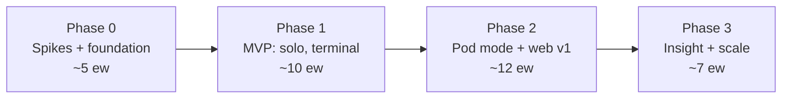
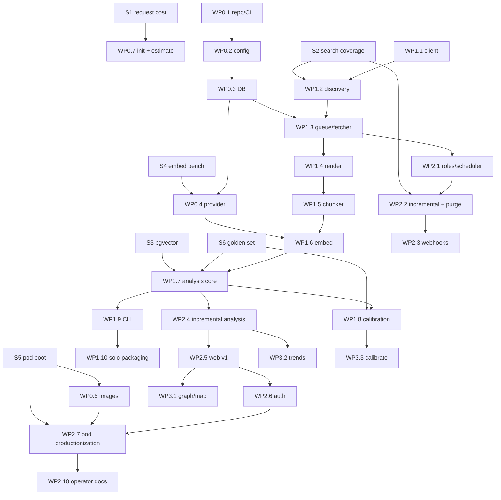

# `ndup` — Implementation Plan

> Target: [architecture-v3.md](./architecture-v3.md) · Language: Python 3.12 · Primary host: RunPod Secure Cloud pod (pod mode) · VM compose mode supported by the same code
> Running log of decisions made while planning: [implementation-notes.md](./implementation-notes.md)

---

## 0. How to read this plan

- **Work packages (WP)** are the unit of delivery. Each lists what it builds, the decisions it closes, its tests, when it is done, its estimate, and what it depends on.
- **Spikes (S)** are time-boxed experiments whose written result changes the plan. They come first because three v2 numbers were guesses and one platform has to be proven before it carries production data.
- **Estimates** are engineer-weeks (ew) and assume **two engineers**: one on ingestion, storage, and operations, one on text, embeddings, and detection. One engineer roughly doubles calendar time. Estimates include tests and docs, not review latency.
- **Language decision, closed:** Python core. Notion caps the system at 3 requests per second, inference runs in ONNX or CUDA, and kNN runs in Postgres, so a Rust core would buy no throughput and would cost the UMAP, HDBSCAN, and calibration tooling. Rust stays an option for a static thin-client binary in Phase 3 and for PyO3 hot paths only if profiling demands.
- **Hosting decision, closed:** RunPod Secure Cloud pod as the team host, with a VM compose deployment as the second supported target. Content never leaves the pod; the pod is rented hardware, which needs a processor agreement before go-live.

---

## 1. Milestones

| Milestone | Exit criteria |
|---|---|
| **M0** end of Phase 0 | All six spikes have written results. `ndup doctor` is green on a dev laptop, in the CPU image, and inside a RunPod pod. The golden synthetic workspace and its labeled pairs exist. CI builds and publishes images |
| **M1** end of Phase 1 | Solo mode syncs a real 10k-doc subset, survives forced restarts without loss or duplication, embeds, analyzes, and `ndup show clusters` lists results. Golden-set F1 ≥ 0.80 for duplicate + near_copy with shipped thresholds. No content egress in tests |
| **M2** end of Phase 2 | Pod mode runs unattended on the full workspace for one week behind Cloudflare Access. Incremental cycle (change → visible in report) under 15 min with webhooks, under 75 min without. Purge verified end to end. Access tests, redaction tests, and the pod boot tests pass. Off-platform backup restores into a fresh pod |
| **M3** end of Phase 3 | Cluster graph, map, topic regions, trends, `calibrate`, ignore UI, thin client shipped. Synthetic 300k-doc / 1M-chunk full analysis under 90 min on the steady-state pod. Zero-install viewer onboarding confirmed with three non-engineers |

---

## 2. Phase 0: De-risk and foundation (≈ 5 ew)

### Spikes

Each spike is time-boxed, runs on a branch, and ends with a one-page result in `docs/spikes/S<n>.md` that names the number it produced and the plan change it triggers.

| # | Question | Method | Box | Changes if the answer is bad |
|---|---|---|---|---|
| **S1** Request cost | How many Notion requests does a real page and a real row cost? | Stratified sample of 300 pages and 300 rows from the target workspace, fetched fully; record requests/doc, nested-container depth, empty-body share | 2 d | Estimates and the `init` ETA formula. If pages average > 6 requests, plan `--root` staging for the first sync and widen the M2 week to include the full first pass |
| **S2** Search coverage | What share of pages and rows does search miss versus tree traversal, and how long is indexing lag? | Three roots (~5k docs): enumerate by search, by traversal, by data-source query; diff. Edit 20 test pages and time their appearance in search | 2 d | Decides whether hourly row discovery can use search. If the miss rate for rows is above 2 %, hourly data-source polling stays mandatory and the webhook decision becomes urgent |
| **S3** pgvector | Does a partial `halfvec` expression index with iterative scan hit ≥ 95 % recall at k=10 under our filters? | testcontainers pgvector 0.8; 100k synthetic 768-d vectors; `EXPLAIN`; recall vs brute force with same-doc and boilerplate filters | 1 d | If recall is low, raise over-fetch to 5× or move FAISS from Phase 3 to Phase 1 |
| **S4** Embedding bench | Real chunks/s for bge-base: ONNX int8 in the CPU image, CUDA in the cuda image on a RunPod 4090 or L4, MPS native on a Mac | `ndup doctor --bench` prototype | 1 d | Updates §6.3 and the pod type recommendation |
| **S5** RunPod pod boot | Can a single container run Postgres on a network volume reliably? | Throwaway `ndup-pod` with Postgres only. Deploy to Secure Cloud with a 50 GB network volume. Test: restart keeps data; stop → deploy CPU pod on the same volume; second concurrent pod is refused by the lease; `cloudflared` tunnel from inside; no inbound ports; confirm RunPod's written statement on volume encryption at rest | 2 d | If restarts lose data or two pods can mount concurrently without protection, pod mode is downgraded to the hybrid alternative and compose on a VM becomes primary |
| **S6** Golden workspace v0 | A labeled dataset exists before any detection code | Generator for ~500 docs: pages and rows, templates, one- and two-chunk docs, non-English, planted near-copies, paraphrases, subsets, partials, same-topic-different-content; ~200 labeled pairs | 3 d | None, but nothing in §9 can be built or measured without it |

### Work packages

**WP0.1 Repository and CI** (0.5 ew)
Builds: `pyproject.toml` with extras `[gpu]`, `[local]`, `[client]`; `uv.lock`; ruff, mypy strict on `src/`, pytest with markers `unit`, `integration`, `e2e`, `scale`; GitHub Actions: lint → unit → integration (testcontainers pgvector 0.8) → image build → publish `ghcr.io/<org>/ndup:{sha,ver}`, `:{ver}-cuda`, `ndup-pod:{ver}`.
Done when: a PR runs the full matrix in under 15 min and a tag publishes three images.

**WP0.2 Config and secrets** (0.5 ew)
Builds: `config.py` (pydantic-settings, profiles, every key in §13 incl. `[deploy]` and `[storage]`), `secrets.py` (lookup order `/run/secrets` → env → keyring; redaction filter for logging; `ndup secrets rotate notion`).
Tests: a secret value never appears in captured logs; env fallback works with no `/run/secrets`.
Done when: `ndup config show --redacted` prints a full resolved config in all three modes.

**WP0.3 Database layer** (1 ew)
Builds: psycopg 3 pool, numbered SQL migrations for every table in §7, `roles.sql` (`ndup_worker`, `ndup_web`), `db/queue.py`, `db/purge.py` skeleton, `ndup db up|down|migrate|status|psql|backup --state-only|--full|reindex`.
Decisions: migrations are forward-only SQL; per-model index DDL is generated at registration, not in migrations.
Tests: migrate from empty and from each prior version; `ndup_web` cannot `DELETE` or `UPDATE` content tables; purge cascades leave no orphan rows.
Done when: schema matches §7 and `EXPLAIN` on the kNN query template shows the partial HNSW index.

**WP0.4 Embedding provider and model registry** (1 ew)
Builds: `EmbeddingProvider` protocol, `st_provider` (ONNX int8 CPU, CUDA, MPS), `fake_provider`, `registry.py` (register model → `embedding_model` row → create both HNSW indexes immediately), `langid.py` with `lid.176.ftz`, `doctor --bench`.
Tests: contract test (dims, L2 norm, determinism); guard test that no provider module imports an HTTP client; **no-egress test** runs embedding inside a network-disabled namespace; fp16 CUDA and int8 CPU register as different model ids.
Done when: S4 numbers reproduce from `doctor --bench` in each runtime.

**WP0.5 Images and deployment artifacts** (1 ew)
Builds: `Dockerfile` (multi-stage; bakes bge-base ONNX int8, PyTorch weights for the cuda variant, `lid.176.ftz`; `HF_HUB_OFFLINE=1`), `Dockerfile.pod` (s6-overlay, Postgres 17 + pgvector, cloudflared, tinyproxy, entrypoint with lease + initdb + migrate), `docker-compose.yml` with the corrected networks (`internal`, `frontend`, `egress`) and worker roles, `docker-compose.solo.yml`, `deploy/runpod/template.json` + `deploy.sh` (REST: create volume, create/stop/swap pods), `deploy/egress-proxy.conf`.
Decisions: the pod image layers on the cuda app image so CPU pods run the same image; Postgres listens on a unix socket only.
Tests: pod boot test matrix from §15 run against a local Docker daemon with a bind-mounted "volume"; compose smoke: `web` reachable from `proxy`, not from the host.
Done when: S5 passes on a real RunPod pod using these artifacts.

**WP0.6 `doctor` and metrics** (0.5 ew)
Builds: checks from v2 §4 plus: pgvector ≥ 0.8, both hashes present on sampled chunks, lease held, volume writable, GPU visible, tunnel connected, Postgres socket-only, last backup age, false-neighbor rate (placeholder until WP3.3); `metrics.py` exposing counters for queue depth, req/s, 429/529 count, embed chunks/s, analysis durations.
Done when: `doctor` exits non-zero on each injected fault in a test harness.

**WP0.7 `init` wizard and estimate** (0.5 ew)
Builds: `ndup init` (token check, roots and labels, exclusions, DB, model check), `notion/estimate.py` (S1 sampling as a reusable command, writes `sync_state.estimate`, prints ETA range), `ndup sync --estimate`.
Done when: ETA printed for the target workspace is within the S1 measured range.

---

## 3. Phase 1: MVP, solo mode, terminal (≈ 10 ew)

**WP1.1 Notion client** (1 ew)
Builds: `notion/client.py` (pinned `Notion-Version`, `429`/`529` with `Retry-After`, jittered backoff on other `5xx`, `filter_properties`), `ratelimit.py` (async token bucket 3/s, burst 3, up to 6 in flight, whole-bucket pause).
Tests: `respx` pagination, 429 and 529 pause the bucket, fake clock proves the average never exceeds 3/s.

**WP1.2 Discovery** (1.5 ew) — depends on S2
Builds: `discovery/search.py` (hint channel, watermark minus lag buffer), `discovery/data_sources.py` (enumerate data sources from search and `GET /v1/databases/{id}`, query all rows, per-source watermark), `discovery/tree.py` (child enqueue hook used by the fetcher), `discovery/ancestry.py` (parent chain resolution, metadata fetch of unknown ancestors, 404 → root), `root` auto-creation and labels, exclusion before fetch, `discovered_via`.
Tests: fixture workspace where search omits 10 % of pages and traversal finds them; ancestry with an unshared ancestor; excluded page never fetched and its title never stored.
Done when: enumeration of the S2 roots by `ndup sync --discover-only` equals the S2 traversal count.

**WP1.3 Work queue and fetcher** (1.5 ew)
Builds: `sync_task` claim with `FOR UPDATE SKIP LOCKED` + lease, block tree fetch with `has_children`, single-transaction write of document + blocks + version + chunks + child tasks, exponential backoff to `failed`, priorities, `ndup sync status` (depth, done/total, req/s, ETA, errors), `ndup sync --root` scoping via traversal.
Tests: kill mid-tree and resume; lease expiry re-claim; cursor expiry restart without duplicates; no partial page ever visible to a reader.
Done when: a 10k-doc subset syncs under three forced kills with identical final row counts.

**WP1.4 Renderer** (1 ew)
Builds: `render.py` block → Markdown with offset map and per-block provenance for every type in §5.8; synced blocks marked; rows prepend title and rich_text properties; structured properties to `properties jsonb`.
Tests: scrubbed JSON fixture per block type → golden Markdown + offset snapshot; property text has no block id and links to the page.

**WP1.5 Chunker and text features** (1.5 ew)
Builds: heading-aware packing (300 target, 512 max, oversize block split), 1-block overlap, `text_hash` and `embed_hash`, MinHash signatures, exact shingle sets at pair time, language ID per chunk and doc, stub flag, boilerplate detectors `hash` and `row_template`, `data_source.template_title` and title-prefix suppression, `chunk.weight`.
Tests: `hypothesis` invariants (max tokens, full coverage, offsets map to blocks, overlap spans deduplicate), templated-title suppression, mixed-language fixtures.
Done when: golden chunk counts and hashes are stable across runs.

**WP1.6 Embed stage** (0.5 ew)
Builds: batch embedding by `embed_hash` with cache hits skipped, COPY into `embedding`, doc vectors (weight × tokens mean, L2) with `source_hash` skip, `ndup embed`.
Tests: re-running embeds nothing; a title change re-embeds the doc's chunks but not identical chunks elsewhere.

**WP1.7 Analysis core** (2 ew) — depends on S3, S6
Builds: `candidates.py` (doc kNN k=20 fetch 60, chunk kNN k=10 fetch 30, hash collisions, iterative scan, literal `model_id`, no `doc_sim` pruning), `templates.py` (density detector feeding `chunk.weight`), `evidence.py` (span coverage with overlap dedup, weights, exact Jaccard and containment), `relations.py` (§9.3 table + short-doc rule), `clustering.py` (undirected core graph, density split, satellites), `stable_keys.py` v1 (largest intersection, tie to older, `member_hash`, `cluster_event`), `provenance.py` (oldest, newest from `last_content_change` with fallback, active copies, passage origin), current-state writes to `doc_pair`, `passage_match`, `cluster*`, `ndup analyze --full`.
Tests: unit tests per module on the golden set; satellites never merge clusters; P/R/F1 per relation reported in CI with a 3-point regression gate.
Done when: F1 ≥ 0.80 on the golden set with shipped thresholds.

**WP1.8 Calibration v1** (0.5 ew)
Builds: `calibrate.py` fit on golden labels → shipped `thresholds` per model with `source = shipped`; p99.9 random-pair floor computed on the real corpus at first full analysis and stored as `p999_floor`.
Tests: fitted τ reproduces within 0.005 across seeds; floor is applied when it exceeds the fitted value.

**WP1.9 CLI surfaces** (1 ew)
Builds: `ndup show clusters|cluster|doc|pair` as Rich tables matching §11, `--json`, `--sort`, `--area`, `--limit`; `ndup review`, `ndup ignore pair|doc|root`, `ndup export --metadata-only` (the only export mode in team profile), `ndup purge --doc` (calls `db/purge.py`).
Tests: `--json` schema snapshot; purge leaves no orphan `embedding` rows and recomputes touched cluster labels.

**WP1.10 Solo packaging and `ndup run`** (0.5 ew)
Builds: `ndup run` (sync → embed → analyze once), solo compose, native `uv tool install "ndup[local]"` path with MPS, laptop quickstart doc.
Done when: M1 criteria hold on a laptop and in the CPU image.

---

## 4. Phase 2: Team server in pod mode + web v1 (≈ 12 ew)

**WP2.1 Worker roles and scheduler** (1 ew)
Builds: `ndup worker --role sync|embed|analyze|all`, schedules coordinated through Postgres (advisory lock leader per role, `sync_state` cursors), hourly incremental, daily users and cold-source polls, weekly reconcile, nightly full analysis; metrics for every schedule.
Tests: two sync workers never both run discovery; a crashed leader is replaced within one interval.

**WP2.2 Incremental sync, reconcile, purge** (1.5 ew) — depends on S2
Builds: search watermark with lag buffer, adaptive per-data-source polling (`poll_interval`, hot window), unchanged-hash metadata touch, weekly reconcile (search + traversal + all data sources, unseen → `GET` → `gone`), `purge_document` complete per §5.7 incl. immediate embedding GC and nightly sweep, version retention, `page.moved` re-resolution and purge on move into an excluded root.
Tests: a doc trashed in the fixture is purged with no text, vector, pair, or label remnant; a doc edited during enumeration is caught next cycle; polling cost stays under the hourly budget with 3k fixture data sources.

**WP2.3 Webhooks** (1 ew) — depends on open item 2
Builds: `web/hooks.py` at `/hooks/notion`, `X-Notion-Signature` verification with the subscription token, `webhook_event` dedup, priority-0 `sync_task` upsert, event-type mapping (content, created, deleted, undeleted, moved, properties, data source events), Cloudflare Access bypass policy template for the path.
Tests: forged and replayed signatures rejected; recorded payloads for each event type produce the right task; receiver works without the Notion API token present.

**WP2.4 Incremental analysis** (1.5 ew)
Builds: touched-doc set (content, weight, status changes since `last_run`) plus current partners, candidates and evidence for that set only, `doc_pair` upsert and deletion of disqualified pairs, component-local recluster, stable keys with `split_from` / `merged_into`, `member_hash` diff → `cluster_review.status = changed`, relation re-derivation from stored scores on threshold change, `ndup analyze --incremental`.
Tests: incremental result equals a full run on the same inputs (property test on the golden set with random edit sequences); a reviewed cluster that gains a member flips to `changed`.

**WP2.5 Web app v1** (2.5 ew)
Builds: FastAPI + Jinja2; routes: overview (counts incl. other-language and stub exclusions, area treemap, area heatmap, cluster table with filters incl. `changed`), cluster detail (member table, timeline via Plotly, satellites marked, membership diff, review controls), pair diff, doc lens (gutter), JSON API mirroring every page; `web/redact.py` applying the §12.4 table from one function; `audit.py`; background job + polling for exports and heavy queries (100 s proxy limit).
Tests: Playwright smoke per page; redaction tests prove `metadata` returns no body text and `snippets` never exceeds 300 chars per passage on every surface including the API; audit rows written for content responses.

**WP2.6 Authentication and authorization** (1 ew) — depends on open items 1 and 6
Builds: `web/auth/` with modes `cloudflare-access` (first), `oauth2-proxy`, `shared-secret`, `tailscale`; JWKS caching; group → role mapping; session cookie + CSRF token on mutating routes; `ndup_web` DB role wired; `ndup login` for the client (Phase 3 completes it).
Tests: a forged `X-Forwarded-Email` without a valid assertion is rejected in every mode; expired or wrong-audience JWT rejected; CSRF enforced; `ndup_web` cannot modify content tables.

**WP2.7 Pod mode productionization** (1.5 ew) — depends on S5
Builds: s6 services for every role with per-role environment injection (Notion token to sync only), boot-time Postgres tuning from pod RAM, analyze working-set cap, lease heartbeat and takeover rules, in-pod backup cron to `deploy.pod.backup_url` with retention, `doctor` pod checks, `deploy.sh` subcommands `create-volume`, `deploy-gpu`, `deploy-cpu`, `swap`, `stop`, runbooks (first sync, GPU→CPU swap, restore into a fresh pod, token rotation, takedown, low-balance alert setup).
Tests: full pod boot matrix from §15 in CI against Docker; restore test from a state-only backup into an empty volume; a staged swap GPU→CPU on RunPod with zero data loss.

**WP2.8 Compose mode parity** (0.5 ew)
Builds: the corrected `docker-compose.yml` runs the same roles on a VM with the proxy container; `setup.sh`.
Tests: compose smoke in CI (web unreachable from the host, reachable from the proxy; db and web have no published ports).

**WP2.9 Optional text encryption** (1 ew, only if open item 5 requires it)
Builds: `storage.encrypt_text` with `pgcrypto` on the three text columns, key from env, transparent decrypt in the repository layer, migration to encrypt in place in batches.
Tests: a `pg_dump` without the key contains no plaintext body; evidence and rendering overhead measured.

**WP2.10 Operator documentation** (0.5 ew)
Builds: setup guides for pod mode and compose mode, SSO examples in `deploy/`, scope-at-source guidance, data boundary statement for the processor agreement, support playbook.
Done when: a second operator deploys a fresh instance from the docs without help.

---

## 5. Phase 3: Insight and scale (≈ 7 ew)

**WP3.1 Cluster graph and workspace map** (2 ew): Cytoscape.js cluster graph (size, badges, directed subset arrows, dotted partials, edge click → pair diff); UMAP fit on a 50k sample and transform of the rest; downsampled tile set; Plotly WebGL scatter with filters and highlight search; HDBSCAN topic regions as hulls.
**WP3.2 Trends** (0.5 ew): from `cluster_event`: new docs joining existing clusters per month, duplication rate per area over time.
**WP3.3 `ndup calibrate` and monitoring** (1 ew): interactive borderline-pair labeling in CLI and web (admin), `calibration_label`, refit with provenance, nightly false-neighbor monitor feeding `doctor` and the overview banner.
**WP3.4 Ignore rules and admin UI** (0.5 ew).
**WP3.5 Thin client** (1 ew): `ndup-client` Python package (no ML deps) with `ndup login` device flow against the chosen SSO; evaluate a Rust static binary only if adoption shows install friction.
**WP3.6 Scale run** (1 ew): synthetic 300k docs / 1M chunks with fake embeddings; time full and incremental analysis on the steady-state CPU pod; memory ceilings; FAISS in-process accelerator behind a flag if kNN dominates.
**WP3.7 Second model** (0.5 ew): bge-large as its own model id on the GPU pod; A/B compare on the golden set and on `calibration_label`.
**WP3.8 Hybrid mode** (0.5 ew, optional): compose on a VM plus a RunPod GPU pod joined over Tailscale for re-embeds, `worker --role embed` only, documented cost model.

---

## 6. Cross-cutting

### 6.1 Test matrix and CI stages
| Stage | Runs on | Content |
|---|---|---|
| lint + types | every push | ruff, mypy strict |
| unit | every push | all `unit` markers, golden renderer and chunker snapshots, `fake_provider` pipeline |
| integration | every push | testcontainers pgvector 0.8: migrations, roles, kNN plans, purge, incremental = full property test |
| quality | every push | golden-set P/R/F1 per relation, 3-point regression gate |
| access | every push | auth modes, redaction table, CSRF, audit |
| images | main and tags | build CPU, cuda, pod images; pod boot matrix; compose smoke |
| scale | nightly | synthetic 300k run timings and memory, reported as a trend |
| e2e | nightly | dedicated test Notion workspace: sync, search-vs-traversal coverage, webhook round trip |

### 6.2 Release and upgrade
- Images are tagged by version; the pod template pins a version. Upgrading a pod is: `deploy.sh swap --image ndup-pod:<ver>`, which stops the old pod, starts the new one on the same volume, and runs migrations at boot under the lease.
- Migrations are expand/contract: a release never drops or renames a column that the previous release reads, because a failed boot must be able to fall back to the previous image on the same data.
- `ndup db backup --state-only` runs before every upgrade.

### 6.3 Observability
Prometheus counters and gauges from `metrics.py`: queue depth by state, Notion req/s, 429 and 529 counts, bucket pause seconds, chunks embedded/s, cache hit rate, analysis stage durations, pairs and clusters current, false-neighbor rate, last backup age, lease age. `doctor` reads the same values. In pod mode, metrics are scraped through the tunnel by the org's monitoring with an Access service token, or pushed to a remote-write endpoint on the egress allow-list.

### 6.4 Security checklist before M2
Notion token present only in the sync role; `web` DB role verified read-mostly; no inbound ports on the pod; all egress through the allow-list; no-egress test green in the pod; forged identity headers rejected; `content_mode` default `snippets`; audit rows for content responses; purge verified; backups off-platform and restore tested; processor agreement signed; encryption-at-rest decision recorded.

---

## 7. Dependency graph

---

## 8. Risk register

| Risk | Trigger | Response |
|---|---|---|
| First sync far longer than planned | S1 shows > 6 requests per page | Stage by `--root`; start with the highest-value areas; extend the M2 unattended week to include the full first pass |
| Search misses rows at scale | S2 row miss rate > 2 % | Keep hourly data-source polling with the adaptive budget; push for webhooks (open item 2) |
| Filtered kNN recall too low | S3 recall < 95 % | Over-fetch 5×; pull FAISS forward into WP1.7 |
| RunPod pod unreliable for a stateful service | S5 loses data on restart or cannot prevent dual mount | Hybrid mode becomes primary (WP3.8 pulled into Phase 2); compose on a VM hosts Postgres |
| GPU class unavailable in the volume's data center | Deploy fails or waits | Pick the data center during S5 by checking both GPU and CPU availability; fall back to CPU embedding, which still finishes inside the sync window |
| Cloudflare not approved | Open item 6 answered no | RunPod HTTP proxy + oauth2-proxy in the container; accept that the URL is public and rely on the app's JWT validation |
| Processor agreement or encryption requirement blocks RunPod | Open item 5 | WP2.9 encryption, or hybrid mode with data at rest on the org VM |
| Golden F1 below 0.80 at M1 | Quality stage fails | Label 50 real borderline pairs early, refit, tighten short-doc rule, check template detectors on real data sources |
| Hourly polling over budget | Metrics show > 30 % of the hourly bucket spent on data-source polls | Lengthen cold interval, shrink hot window, enable webhooks |
| Volume terminated on zero balance | Billing alert | Daily off-platform state backup already in place; restore runbook; prepaid balance policy |
| Content egress regression | No-egress test fails or `doctor` egress check fails | Release blocked; the test is a required CI gate |

---

## 9. Decisions needed from the author

| # | Decision | Blocks | Needed by |
|---|---|---|---|
| 1 | SSO stack and IdP (Okta / Google / Entra) | WP2.6 | start of Phase 2 |
| 2 | Expose `/hooks/notion` through the tunnel, yes or no | WP2.3, incremental latency target | start of Phase 2 |
| 3 | RunPod data center (needs network volume + GPU class + CPU pods) | S5, WP2.7 | S5 |
| 4 | Processor agreement with RunPod; encryption-at-rest requirement | M2 go-live, WP2.9 | before the unattended week |
| 5 | Cloudflare account for Tunnel + Access | WP2.6, WP2.7 | start of Phase 2 |
| 6 | First audience boundary: which roots get connected and labeled | first full sync | M1 |
| 7 | GPU pod class for first sync and re-embeds (4090 / L4 / A40) | S4, S5 | S4 |

---

## 10. Estimate summary

| Phase | Engineer-weeks | Calendar with 2 engineers |
|---|---|---|
| Phase 0 | ~5 | ~3 weeks |
| Phase 1 | ~10 | ~5–6 weeks |
| Phase 2 | ~12 | ~6–7 weeks |
| Phase 3 | ~7 | ~4 weeks |
| **Total** | **~34** | **~18–20 weeks** |

Excludes the first full sync's wall-clock time, which is bounded by Notion's rate limit and runs unattended once Phase 1 is done.
